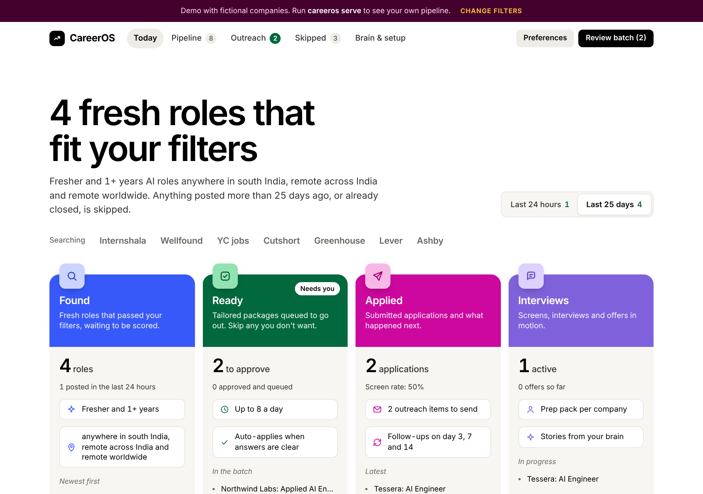
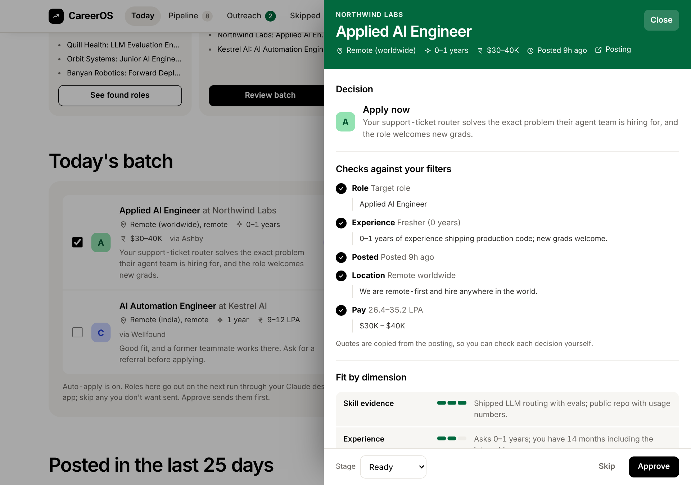
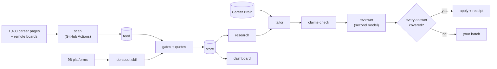

# CareerOS

**An open-source job-application agent that finds fresh roles, checks each one against your filters with quotes from the posting, writes truthful tailored applications, and applies when it can answer every question. Everything else comes to you.**

Built for Claude Code. Works with Codex and Antigravity.



**[Browse the live job board](https://vishstack01.github.io/careeros/)**: every open role the scan finds, updated hourly, with a free JSON API and RSS · **[Dashboard demo](https://vishstack01.github.io/careeros/demo/)** (fictional companies)

---

## Why it's different

Most job bots optimise the weakest variable: volume. They read job cards instead of postings, invent resume lines, guess form answers and sometimes submit twice. CareerOS is built the other way round.

- **Interviews, not application count.** A daily cap, freshness priority, referral-first decisions and honest skips.
- **Evidence, not keywords.** Every resume line cites a claim in your Career Brain. A code gate blocks numbers, tools or projects the brain can't back up.
- **It shows its work.** Every keep or skip records the exact sentence from the posting that decided it.
- **It scores before it applies.** Each role gets a 1–5 score against your Career Brain, requirement by requirement, with the gaps and how to handle them. Under 4.0, auto-apply waits for you.
- **It applies only when it can answer everything.** Each form answer has a confidence. Sensitive fields, essays nobody wrote, captchas and logins go to you.
- **One submit per role, ever.** An idempotent state machine, receipts with screenshots, and a kill switch.
- **Platform-safe.** No LinkedIn or Indeed automation, no account creation, no captcha solving. Outreach is drafted; you send it.
- **Where the openings are first.** About 1,400 product companies' career pages, read straight from their hiring systems every hour, before roles reach the big boards.

## Coverage

| Source | How many | How |
|---|---|---|
| Company career pages | 1,396 product companies: Indian product companies, India engineering centres, the [moreThanFAANGM](https://github.com/Kaustubh-Natuskar/moreThanFAANGM) list, and YC companies in India or hiring remotely | Public feeds of 8 hiring systems (Greenhouse, Lever, Ashby, Workable, SmartRecruiters, Recruitee, Breezy, Personio), scanned every hour on GitHub Actions. [docs/feed.md](docs/feed.md) |
| Remote job boards with feeds | 9 | Remote OK, Remotive, Himalayas, Jobicy, Working Nomads, We Work Remotely, HN jobs, HN "Who is hiring?", Arbeitnow |
| Other platforms | 96 in the registry, 50 low-competition | 26 VC portfolio boards, Indian startup and fresher boards, 11 x-ray searches that find career pages on Keka, Zoho Recruit, Darwinbox and others. [docs/platforms.md](docs/platforms.md) |
| Big boards | LinkedIn, Naukri, Indeed, foundit, Glassdoor, Shine | Their own email alerts only; never automated |

## The job board

The hourly scan also publishes a public job board on GitHub Pages, in the spirit of Arbeitnow: search, filters with counts (where you can work from, experience, posted date, contract, category, skills, perks), a page per role with the full posting and the quoted facts, and a page per company. Only roles still open and posted in the last 60 days are listed.

| Endpoint | What |
|---|---|
| [`/api/jobs.json`](https://vishstack01.github.io/careeros/api/jobs.json) | 100 roles per page, newest first; `links.next` points to `api/jobs/page-2.json` |
| [`/feed.xml`](https://vishstack01.github.io/careeros/feed.xml) | RSS of the 100 newest roles |
| `/data/jobs/<id>.json` | One role with its full text and facts |

Build it yourself with `careeros site --feed feed --out site`.

## Auto-apply

The dashboard has an **Auto-apply** switch. Fill in your application details and upload your resume on the dashboard, then a scheduled task in the Claude desktop app applies from your computer's browser, where you sign in to job sites yourself:

- roles you press **Auto-apply** on go first, then, with the switch on, roles whose must-have requirements your resume or Career Brain can back up;
- newest and remote-worldwide roles first, up to your daily cap;
- every field comes from your saved details; short "why us" answers use one real proof point; a tailored resume once your Career Brain is built;
- it stops and lists the role under **Auto-apply needs you** with the exact reason for a sign-in, captcha, one-time code, assessment or any answer it would have to guess.

It never stores passwords, Aadhaar, PAN, bank details, passport or date of birth, and never applies through LinkedIn, Naukri or Indeed. The run's instructions: [prompts/scheduled-apply.md](prompts/scheduled-apply.md).

## CareerOS Cloud: for many job seekers

The same product as a multi-user service: people sign up with their email, set their filters, upload their resume and get matched against the shared hourly inventory, each with a private pipeline. Auto-apply still runs on each person's own computer, in the Claude desktop app, with a computer key that can only read their pipeline and report results; the server never fills employer forms or holds job-site logins.

- Accounts with email verification, password reset, sign-out everywhere, export and self-service deletion
- PostgreSQL with versioned migrations, a worker with a durable task queue, fail-closed feed ingestion
- Deploy with Docker Compose (HTTPS through Caddy) or the Render blueprint

```bash
pip install -e ".[cloud]"
careeros cloud serve      # http://127.0.0.1:8000, SQLite, emails printed to the terminal
careeros cloud worker     # ingests the feed and matches every account
```

Architecture, deployment and operations: **[docs/cloud.md](docs/cloud.md)**. Before inviting anyone: **[the release checklist](docs/cloud-release-checklist.md)**.

## What it does

| Stage | What happens | How |
|---|---|---|
| Brain | Interviews you and turns your career into claims with evidence | `career-brain` skill, `careeros brain-check` |
| Discover | Scans ~1,400 career pages and 9 remote boards every hour; the agent covers the rest of the 96 platforms | `careeros discover`, `scan`, `filter-feed`, `job-scout` skill |
| Gate | Role, seniority, experience, freshness, open, location, pay, dealbreakers, company; each with a quote | `careeros/gates.py` |
| Check | Still open? A real opening? Re-listed? Work authorization you can meet? | `careeros liveness`, `careeros/signals.py` |
| Research | Company brief, the three problems the team needs solved | `company-research` skill |
| Score | 1–5 against your brain with evidence per requirement, gaps, confidence and a verdict; 4.0 is the apply line | `evaluate` skill, `careeros eval-check` |
| Tailor | Resume where every bullet cites the brain, an ATS-safe PDF checked line by line, cover note, screening answers, keyword coverage, cliché check | `tailor` skill, `careeros claims-check`, `render`, `keywords`, `writing-check` |
| Review | Independent model checks claims, defensibility, 6-second scan, objections | `reviewer` skill |
| Apply | Fills the company's form, submits only when every required answer is covered | `careeros apply`, `apply` skill |
| Outreach | Referral asks to people you already know, hiring-manager, recruiter and LinkedIn notes, follow-ups on day 7 and 14 | `outreach` skill, `careeros warm-intros`, `followups` |
| Track & learn | Inbox sync, funnel, score calibration, skills gap, weekly experiment | `tracker`, `weekly-review` skills, `careeros stats`, `calibrate`, `gaps` |
| Interview & offer | Prep plan, practice, debriefs, red flags, offer-letter walk-through, negotiation brief | `coach` skill, `careeros salary-gap` |



## Quick start

```bash
git clone https://github.com/VishStack01/careeros.git && cd careeros
pip install -e ".[browser,dev]" && python -m playwright install chromium
careeros init                    # creates your private config files
careeros scout                   # poll your watchlist, gate every role
careeros discover && careeros scan   # or: build the 1,400-company India feed
careeros serve                   # dashboard at http://127.0.0.1:8765
```

Then open Claude Code in the folder and say *"Use the career-brain skill"* with your resume attached. The full walkthrough, including Codex, Antigravity, cron and a fully hosted setup on claude.ai, is in **[docs/build-your-own.md](docs/build-your-own.md)**.

Try the gates on any posting:

```bash
careeros evaluate --company "Demo Co" --title "Junior AI Engineer" --location "Remote, India" \
  --mode remote --text-file posting.txt
```

## Architecture



Code handles everything with a right answer (dates, experience parsing, dedupe, refusing a second submit); agents handle judgement (interviewing, research, writing, review). Details: **[docs/architecture.md](docs/architecture.md)**.

## Repository map

```
careeros/            Python package (standard library only; Playwright optional)
  sources/           8 hiring-system scouts and 9 remote-board feeds
  discover.py        find each company's job board
  scan.py, feed.py   build the India feed; apply your filters to it
  platforms.py       the job-platform registry and per-run rotation
  extract.py         experience, work mode, remote scope, pay, dates
  gates.py           the gatekeeper
  store.py           SQLite docs, dedupe keys, submit state machine, audit log
  claims.py          resume truth gate, and the same check on the PDF
  signals.py, liveness.py  real-opening signals, re-listing, work authorization, still open?
  evaluation.py      the 1-5 score and its rules
  render.py, jd.py   ATS-safe PDFs; posting archive
  keywords.py, writing.py  keyword coverage; cliché check
  followups.py, replies.py, analytics.py, connections.py  tracking and warm intros
  salary_gap.py, funded.py, doctor.py
  apply/answers.py   form-answer resolver with confidence
  apply/runner.py    Playwright form filler
  site.py, tags.py   the public job board and its tags
  cloud/             the multi-user service: API, worker, migrations, sign-in pages
  server.py, cli.py  local dashboard API and command line
.claude/skills/      agent skills: career-brain, job-scout, company-research, evaluate,
                     tailor, reviewer, apply, outreach, tracker, coach, weekly-review
dashboard/           app.html (single source), demo data, built index.html
prompts/             scheduled search and apply prompts
config/companies/    the company list (curated + moreThanFAANGM + YC), 1,396 companies
config/platforms.toml  96 job platforms with access and competition
config/, brain/      example settings, watchlist, profile and brain
examples/            a tailored resume, an application package, a posting and its evaluation
docs/                architecture, how it works, accuracy, apply agent, data model, guides
tests/               209 tests, including real browser form fills and the cloud service on SQLite and PostgreSQL
```

## Docs

- [How it works, step by step](docs/how-it-works.md)
- [The India feed: 1,400 career pages](docs/feed.md)
- [Job platforms](docs/platforms.md)
- [Architecture](docs/architecture.md)
- [What makes it accurate](docs/accuracy.md)
- [Scoring, documents, tracking and interviews](docs/features.md) (ideas from career-ops)
- [The apply agent](docs/apply-agent.md)
- [Data model](docs/data-model.md)
- [CareerOS Cloud (multi-user)](docs/cloud.md) and its [release checklist](docs/cloud-release-checklist.md)
- [Build your own](docs/build-your-own.md)
- [Responsible use](docs/responsible-use.md)
- [Roadmap](docs/roadmap.md)
- [AGENTS.md](AGENTS.md): instructions for Claude Code, Codex and Antigravity

## Status

Phases 0–4 and 7 of the blueprint are built and tested; learning and interview layers ship as skills. See the [roadmap](docs/roadmap.md).

## Responsible use

It never invents experience or fakes a shortlist percentage, never automates LinkedIn or Indeed, never handles passwords or captchas, and keeps your data in git-ignored files on your machine. Read [docs/responsible-use.md](docs/responsible-use.md) before you schedule it.

## License

MIT. Built by [VishStack](https://github.com/VishStack01) with Claude. The scoring, posting checks, follow-up cadence and interview modes adapt ideas from [career-ops](https://github.com/career-ops-hq/career-ops) (MIT); see [docs/features.md](docs/features.md).
